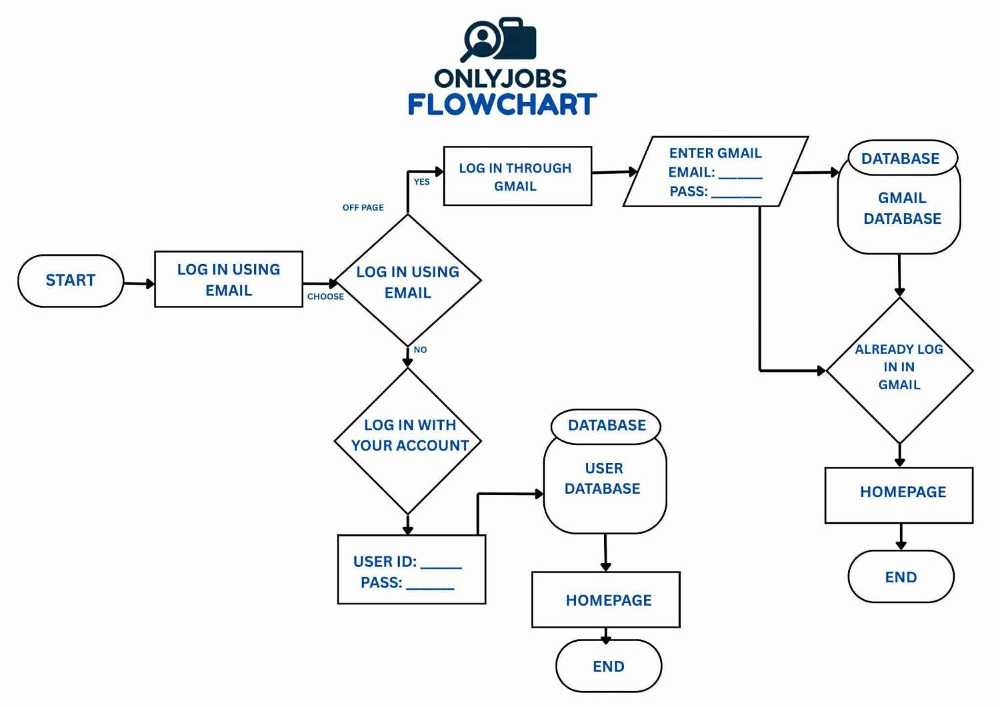

# OnlyJobs: Job Finder Website

A website where users can log in and look for jobs.

> Team project for BSIT at Datamex College of Saint Adeline.

## Login flowchart

We planned the login process with a flowchart before building the website.

## How the login works

1. The user chooses how to log in.
2. **Option 1: User account.** The user enters a User ID and password. The system checks the **user database**, then opens the homepage.
3. **Option 2: Gmail.** The user enters their Gmail and password. The system checks the **Gmail database**, then opens the homepage.

## What I learned

- How to plan a system with a flowchart before coding
- How a login system checks user details against a database
- Common flowchart symbols: start/end, process, decision, input, and database
